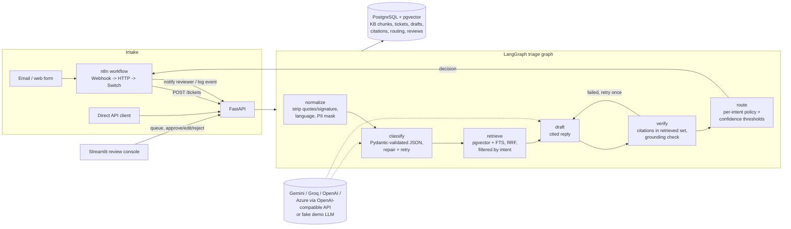

# TriageDesk

A support-ticket triage agent for merchant support at a payment gateway. It classifies each
ticket by intent, retrieves the relevant help-center articles, drafts a reply that cites them
inline, checks the citations, and routes the ticket to auto-send, human review, or escalation.
The routing follows a per-intent risk policy. Reviewers approve, edit or reject drafts, and every
decision is stored in PostgreSQL, so you can measure which ticket categories are safe to automate.

The domain is **Northwind Pay**, a fictional Indian payment gateway. Its customers are merchants
(D2C stores, SaaS companies, marketplaces) who raise tickets about failed UPI/card payments,
refunds and ARNs, T+2 settlements and MDR/GST deductions, chargebacks, KYC holds, checkout
integration, API keys, webhooks, and payouts. The 49 help articles and 189 labelled tickets in
this repo are fictional and were written for this project.

**Who it is for:** a support or operations team that wants to:
- cut first-response time on repetitive developer and how-to tickets;
- keep humans on anything that moves money or touches identity;
- show, with numbers, where automation is safe.



## What is in the repo

| Path | What it is |
|---|---|
| `src/triagedesk/graph.py` | LangGraph `StateGraph`: normalize, classify, retrieve, draft, verify, route, with a verify-to-draft retry loop |
| `src/triagedesk/normalize.py`, `pii.py` | Strip quoted replies and signatures; detect language (including Hinglish); mask email, phone, card (Luhn-checked), PAN, Aadhaar (Verhoeff-checked), UPI ID, account numbers, secrets; keep UPI RRNs and UTRs |
| `src/triagedesk/json_repair.py`, `schemas.py` | JSON extraction and repair for LLM output (code fences, trailing commas, single quotes, unquoted keys); Pydantic models that normalise sloppy enum values |
| `src/triagedesk/chunking.py`, `ingest.py` | Heading-aware markdown chunking (headings inside code fences are ignored); incremental ingest keyed on content hash |
| `src/triagedesk/retrieval.py` | Hybrid search: pgvector cosine plus Postgres full-text search, fused with Reciprocal Rank Fusion (k=60), filtered by intent category |
| `src/triagedesk/verify.py` | Citation and grounding checker |
| `src/triagedesk/policy.py`, `config/automation_policy.yaml` | Routing policy: a risk class, auto-send flag, confidence threshold, team and escalation urgencies for each intent |
| `src/triagedesk/llm.py`, `fake_llm.py` | OpenAI-compatible client with retries and backoff (Gemini, Groq, OpenAI, Azure, custom); a deterministic fake LLM for demo mode |
| `src/triagedesk/api.py`, `store.py`, `schema.sql` | FastAPI service and Postgres persistence |
| `src/triagedesk/eval.py`, `data/eval/tickets.jsonl` | Evaluation harness and 189 labelled tickets |
| `ui/` | Streamlit review console: queue, ticket view with clickable citations, approve/edit/reject, metrics |
| `n8n/`, `docker-compose.n8n.yml` | n8n workflow (auto-imported and published on startup) |
| `kb/articles/` | 49 help-center articles across 11 categories |

## Intents and the automation policy

The intent taxonomy is fixed at 12 labels:
- 11 business intents, which are also the knowledge-base categories: `refunds`, `failed_payments`, `settlements`, `payouts`, `disputes`, `kyc`, `account_access`, `api_keys`, `webhooks`, `checkout`, `billing`;
- one catch-all, `other`.

Routing is driven by risk, not only by confidence:

| Risk class | Intents | Policy |
|---|---|---|
| money_movement | refunds, settlements, payouts, disputes | Never auto-sent; a human checks the specific transaction. Escalated when urgency is high or critical. |
| regulated | kyc, account_access | Never auto-sent (identity, compliance, account takeover risk). account_access escalates at high urgency. |
| informational | failed_payments, api_keys, webhooks, checkout, billing | May auto-send when every gate passes and confidence is at or above the threshold for that intent (0.85 or 0.9). |

The router checks these gates for every ticket. Any failing gate sends the ticket to human
review; an escalation trigger sends it to escalation instead:
- classifier failed after retries;
- confidence below the threshold;
- multi-intent ticket;
- no draft;
- verification failed;
- negative sentiment;
- unsupported language;
- the draft asked for escalation;
- critical urgency (escalates any intent).

Every decision is stored with its reasons, the team, and the policy version.

## Quickstart (Docker)

```bash
cp .env.example .env            # LLM_PROVIDER=fake by default: runs fully offline in demo mode
docker compose up -d --build    # Postgres+pgvector :15433, API :8401, review UI :8502
curl -s localhost:8401/health
```

The API ingests the knowledge base on startup. Ingest is incremental, so restarts skip unchanged
articles. The embedding model (BAAI/bge-small-en-v1.5 via fastembed) is baked into the image.

With n8n (port 5679), which imports and publishes the workflow automatically:

```bash
docker compose -f docker-compose.yml -f docker-compose.n8n.yml up -d --build
curl -s -X POST localhost:5679/webhook/ticket -H 'Content-Type: application/json' \
  -d '{"subject":"Webhook signature mismatch","body":"Our endpoint rejects every event, the X-Northwind-Signature never matches. We compute the HMAC on the parsed JSON."}'
```

Stop and remove everything with `docker compose -f docker-compose.yml -f docker-compose.n8n.yml down -v`.

### Demo mode

`LLM_PROVIDER=fake` swaps the LLM for `FakeLLM`:
- **Classification:** a keyword scorer.
- **Drafting:** copies the best-matching sentences from the retrieved excerpts, with their citations.

It is labelled everywhere: `/health`, every ticket response (`notice`), the review UI banner and
the eval report. It exists so the graph, API, n8n flow, UI and tests run without a key. Its
outputs are not LLM quality and are not reported as such.

### Using a real model (Gemini, Groq, OpenAI, Azure)

```bash
# Gemini (OpenAI-compatible endpoint, preset fills base URL and model gemini-2.5-flash)
LLM_PROVIDER=gemini LLM_API_KEY=... docker compose up -d
# Groq (free tier; preset: llama-3.3-70b-versatile)
LLM_PROVIDER=groq LLM_API_KEY=gsk_... docker compose up -d
# Azure OpenAI: base URL is the resource endpoint, model is the deployment name
LLM_PROVIDER=azure LLM_BASE_URL=https://<resource>.openai.azure.com LLM_MODEL=<deployment> LLM_API_KEY=...
```

**Getting a free Groq key:**
1. Sign in at https://console.groq.com with a Google or GitHub account.
2. Open **API Keys** and click **Create API Key**.
3. Copy the `gsk_...` value into `LLM_API_KEY` in `.env`.

The free tier is rate-limited per minute and per day. Use `--delay` in the eval to stay under it.

A Gemini key comes from https://aistudio.google.com/apikey and also has a free tier.

### Local development (without Docker for the app)

```bash
uv venv --python 3.12 .venv && uv pip install --python .venv/bin/python -e '.[ui,dev]'
docker compose up -d db                       # only Postgres
.venv/bin/python -m triagedesk.ingest         # chunk + embed the KB (incremental)
.venv/bin/uvicorn triagedesk.api:create_app --factory --port 8401
API_URL=http://localhost:8401 .venv/bin/streamlit run ui/app.py --server.port 8502
```

## Configuration

All settings are environment variables, read by `pydantic-settings` (`src/triagedesk/config.py`).
`.env.example` lists them all.

| Variable | Default | Notes |
|---|---|---|
| `LLM_PROVIDER` | `fake` | `fake`, `gemini`, `groq`, `openai`, `azure`, `custom` |
| `LLM_API_KEY` / `LLM_BASE_URL` / `LLM_MODEL` | preset | Presets fill base URL and model |
| `LLM_TIMEOUT_S`, `LLM_MAX_RETRIES` | 30, 3 | Exponential backoff with jitter; honours `Retry-After` on 429 |
| `LLM_JSON_MODE` | true | Sends `response_format=json_object`; falls back automatically if rejected |
| `EMBEDDINGS_PROVIDER` | `fastembed` | `fastembed` (local), `api` (provider `/embeddings`), `hash` (tests) |
| `EMBEDDINGS_MODEL`, `EMBEDDINGS_DIM` | bge-small-en-v1.5, 384 | A change of embedder triggers a full re-embed |
| `DATABASE_URL` | localhost:15433 | |
| `KB_BASE_URL` | `http://localhost:8401/kb` | Citation links; the API serves `/kb/{id}` |
| `POLICY_PATH` | `config/automation_policy.yaml` | |
| `RETRIEVAL_TOP_K`, `RRF_K` | 5, 60 | |

## API

| Method | Path | Purpose |
|---|---|---|
| POST | `/tickets` | Ingest and triage a ticket (synchronous). `Idempotency-Key` header or `external_id` makes retries safe: a replay returns 200 with the stored result |
| GET | `/tickets` | Queue, filterable by `status`, `intent`, `decision`, `urgency`; ordered by urgency, then age. Subjects are PII-masked |
| GET | `/tickets/{id}` | Ticket with classification, draft, citations, retrieved passages, routing reasons, review and events. Raw body and email only with `include_raw=true` |
| POST | `/tickets/{id}/review` | `approve`, `edit` (needs `final_body`) or `reject`. Records the Levenshtein edit distance and ratio, plus handling time (`handling_seconds`, or computed from `started_at`). Edited text is re-verified, and citation warnings are returned. A second review returns 409 |
| POST | `/tickets/{id}/events` | Append an event (used by n8n to log notifications) |
| GET | `/metrics` | Routing mix, auto-send rate, per-intent acceptance and edit ratio, handling time, citation validity, triage latency |
| GET | `/health` | Database and KB status, provider, demo flag (503 when degraded) |
| GET | `/kb`, `/kb/{id}` | Article index and rendered article pages (targets of citation links) |

```bash
curl -s -X POST localhost:8401/tickets -H 'Content-Type: application/json' -H 'Idempotency-Key: mail-123' \
  -d '{"subject":"401 on orders API","body":"Getting 401 AUTHENTICATION_ERROR when calling the orders API with our new key.","channel":"email"}'
curl -s 'localhost:8401/tickets?decision=human_review&limit=20'
curl -s -X POST localhost:8401/tickets/<id>/review -H 'Content-Type: application/json' \
  -d '{"action":"edit","reviewer":"asha","final_body":"...","started_at":"2026-11-04T10:00:00Z"}'
curl -s localhost:8401/metrics
```

Errors are JSON: `422` validation (unknown fields are rejected), `404`, `409` already reviewed,
`502` triage failure (the ticket is kept with status `triage_failed`), `500` with a request id.
Every response carries `x-request-id`. Logs are structured JSON lines.

## Design decisions and trade-offs

- **Risk class over confidence.** A well-calibrated 0.99 on "where is my settlement" is still not
  auto-sent: the honest answer depends on that merchant's settlement, which the KB cannot know. The
  eval reports measured precision for those intents anyway, so the recommendation table shows
  when the data would allow automation and why policy still says no.
- **Hybrid retrieval with RRF.** Merchant tickets mix exact tokens (`AUTHENTICATION_ERROR`,
  `X-Northwind-Signature`, `T+2`) with vague symptoms ("got 9,764 instead of 10,000"). Full-text
  search catches the tokens; dense vectors catch the paraphrases. RRF fuses ranks, so no score
  calibration is needed. Ticket text is long, so the FTS query ORs the ticket's lexemes; the AND
  semantics of `websearch_to_tsquery` would match almost nothing. The lexemes come from Postgres's own
  `to_tsvector`, so identifiers like `payment.captured` are normalised exactly as at index time.
  They are quoted and cast, so user text cannot inject tsquery operators.
- **Intent-filtered retrieval, with an escape hatch.** Retrieval is filtered to the predicted intent's
  category only when confidence is at least 0.5 and the intent is not `other`. Secondary intents add
  their own top-2 chunks, and the top-2 unfiltered hits are always merged in, because some answers
  live in another category (for example, a settlement held for KYC).
- **Verification without an LLM.** A citation must point to an article in the retrieved set
  (fabricated ids fail). Each cited sentence must share at least 50% of its content words with
  the cited excerpts, and every number in it (fees, days, limits) must appear there. A factual
  sentence without a citation fails. The check is cheap, deterministic and testable. It is
  lexical, so it can be fooled by a paraphrase with flipped meaning; an LLM-judge pass is on the
  roadmap. A failed draft gets one redraft that is told the issues, then goes to a human.
- **Classifier robustness.** JSON is extracted and repaired, then validated by Pydantic with
  synonym normalisation (for example, `chargeback` becomes `disputes` and `85%` becomes 0.85).
  An invalid result is re-asked with the error, up to 3 attempts. If that fails, the fallback
  classification sends the ticket to a human. A provider outage never drops a ticket.
- **PII.** The LLM only ever sees masked text. Gateway object ids (`pay_...`, `rfnd_...`) are kept
  because support needs them. Raw text stays in Postgres for audit, but is excluded from default
  API responses.
- **Synchronous triage.** `POST /tickets` returns the full decision, which keeps the n8n flow
  simple (one HTTP call, then a Switch). Production volume would need a queue; see the roadmap.

## Tests

```bash
.venv/bin/python -m pytest -q                    # everything; Postgres tests start pgvector via testcontainers
.venv/bin/python -m pytest -q -m "not integration"   # no Docker needed
TEST_DATABASE_URL=postgresql://... .venv/bin/python -m pytest -m integration   # use an existing DB (CI)
.venv/bin/ruff check src tests
```

The suite covers:
- chunking (heading paths, code fences, merge and split);
- RRF math and tie-breaking;
- tsquery sanitisation;
- hybrid retrieval and category filters, both in memory and on real pgvector;
- classifier JSON repair, the retry-with-feedback loop and fallback;
- citation verification (fabricated, out-of-set, wrong-number and wrong-article citations are rejected);
- every routing gate and the risk classes;
- PII masking for each type, including Luhn checks and keeping gateway ids;
- the LLM client (retries on 429/5xx/timeouts, `Retry-After`, the JSON-mode fallback, the Azure URL shape);
- graph flows with fake and scripted LLMs (redraft loop, outage degradation, escalation);
- the API endpoints against real Postgres (idempotency, review conflicts, validation, PII hiding, metrics, events);
- the review UI.

RESULTS_TESTS_PLACEHOLDER

## Evaluation

```bash
python -m triagedesk.eval --retrieval-only        # no LLM needed
python -m triagedesk.eval --provider gemini       # full run (needs LLM_API_KEY); add --delay 2 for free tiers
```

**Dataset:** `data/eval/tickets.jsonl` has 189 merchant tickets. Each one carries:
- a gold intent, plus any secondary intents;
- one to three gold articles;
- a gold `should_automate` label.

The mix includes 15 multi-intent tickets, 8 genuinely ambiguous ones, 19 in Hinglish, and 20 with
fake PII, signatures or quoted replies. `should_automate` is true only for single-intent
informational how-to tickets that the gold article fully answers (54 tickets). Tickets were
written to describe symptoms rather than repeat article titles.

**Metrics reported:**
- routing accuracy (accuracy, macro-F1, per-intent precision and recall, confusion matrix);
- retrieval hit@k and MRR against the gold article;
- citation validity;
- per-category auto-resolution rate: the share of tickets the policy would auto-send whose draft is acceptable;
- simulated and recorded handling time;
- a per-intent recommendation table that says whether each category is safe to automate, and at what threshold.

### Results: measured on this machine (2026-11-04)

**Retrieval (no LLM involved).** Command: `python -m triagedesk.eval --retrieval-only`.

The run used the KB ingested by the Docker API into pgvector, with fastembed
`BAAI/bge-small-en-v1.5` embeddings: 49 articles, 180 chunks. It covered the 177 tickets that
have a gold article; the 12 `other` tickets were skipped. Chunks are collapsed to unique articles
before scoring, and a hit means a gold article appears in the top k.

| Mode | hit@1 | hit@3 | hit@5 | MRR@10 | recall@5 |
|---|---|---|---|---|---|
| Hybrid (pgvector + FTS, RRF), unfiltered | 0.661 | 0.864 | **0.932** | 0.771 | 0.858 |
| Vector only | 0.622 | 0.842 | 0.898 | 0.740 | 0.816 |
| Full-text only | 0.548 | 0.785 | 0.842 | 0.681 | 0.773 |
| Hybrid, filtered to the gold intent's category | 0.831 | 0.983 | **1.000** | 0.905 | 0.944 |

What this shows:
- Hybrid beats either retriever alone.
- Filtering by intent (what the graph does when the classifier is right) lifts hit@1 from 0.66 to 0.83.
- Accurate classification matters for retrieval as well as routing.
- Weakest slices of unfiltered hybrid: ambiguous tickets (8 tickets, hit@5 0.500) and payouts (hit@1 0.471). Payout and settlement vocabulary overlaps.

**Pipeline plumbing check in demo mode (not an LLM result).** Command: `python -m triagedesk.eval --provider fake`.

All 189 tickets ran through the real graph and Postgres retrieval, with 0 errors and 0 classifier
fallbacks. The fake keyword classifier is a baseline that exists only to exercise the code. It
scored accuracy 0.630 and macro-F1 0.624. Its keyword lists were written before the ticket set existed.

The verifier accepted 186 of 189 extractive drafts. Every one of the 331 citations was in the
retrieved set, which is expected, because the fake drafter copies retrieved sentences. These
numbers show the harness works. They say nothing about Gemini or Groq quality.

The risk policy worked as designed. No refunds, settlements, payouts, disputes, KYC or
account-access ticket was auto-sent. The per-intent table labels them "never (money_movement)" or
"never (regulated)", whatever their measured precision.

### Results: pending a live run

These need a real model. There is no LLM key on the build machine, so none were measured:
- routing accuracy and macro-F1 for Gemini or Groq;
- the confusion matrix;
- citation validity of generated drafts;
- per-category auto-resolution rate;
- the safe-to-automate threshold table.

Produce them with:

```bash
LLM_PROVIDER=gemini LLM_API_KEY=... python -m triagedesk.eval --delay 1
LLM_PROVIDER=groq   LLM_API_KEY=gsk_... python -m triagedesk.eval --delay 2
```

Recorded handling time comes from real reviewer actions (`POST /tickets/{id}/review`), surfaced
in `/metrics` and the eval report. No reviewer sessions have been recorded yet, so no
handling-time numbers are reported.

## Limitations

- The KB and tickets are synthetic, written for this project. Retrieval numbers on them are a
  sanity check of the pipeline, not a claim about real merchant traffic. Gold labels were written
  by one author.
- Grounding is lexical (token overlap plus exact numbers). It catches fabricated ids and changed
  figures, not subtle semantic contradictions.
- Triage is synchronous inside the request. With a real LLM it takes a few seconds per ticket.
- Language detection treats Hinglish heuristically (marker words); other Indic scripts are routed
  to humans.
- The demo-mode drafts are extractive and read awkwardly by design. They are not LLM output.

## Roadmap

- Background worker (queue) for triage, with retries and dead-lettering; webhook callback when done.
- LLM-judge grounding check as a second verifier stage, calibrated against reviewer edits.
- Confidence calibration (isotonic) per intent from reviewer outcomes; thresholds tuned from `/metrics`.
- Prometheus exposition format for `/metrics`; OpenTelemetry traces per graph node.
- Reviewer authentication and role-based access to raw PII in the UI.
- Gmail/IMAP intake enabled by default with OAuth credentials; outbound send from n8n after approval.
- Multilingual embeddings for Hindi in Devanagari script.

## License

MIT, see `LICENSE`.
