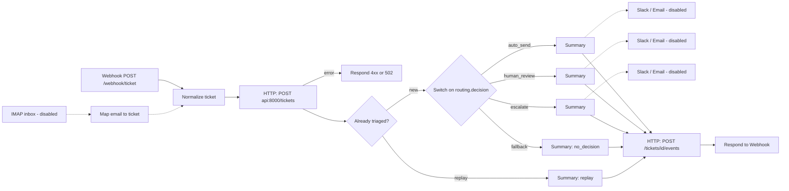

# n8n intake workflow

`workflows/triage.json` is an n8n workflow that puts TriageDesk behind a webhook (or a mailbox).
It calls the triage API, branches on the routing decision, and answers the caller with
`{ticket_id, decision, intent, ...}`. It is pinned to and tested against `n8nio/n8n:2.40.0`.



What each part does:

- **Normalize ticket** accepts `{subject, body, customer_email, external_id}` (it also accepts `message`
  and `email` as aliases). If there is no `external_id`, it uses the `Idempotency-Key` header, and failing
  that, `n8n-<execution id>`. The API treats `external_id` as an idempotency key, so HTTP retries and
  duplicate webhook deliveries never create a second ticket.
- **Triage API** posts to `http://api:8000/tickets`, the API's port inside the compose network. It has a
  120 s timeout and 3 tries. If the call still fails, the error output responds with the API's 4xx
  status (for example `422` for an empty body) and the API's detail. Any other failure, such as the API
  being unreachable or returning a 5xx, becomes a `502`.
- **Already triaged?** A replayed ticket (`idempotent_replay: true`) skips the notification branches,
  so a retried webhook never pages anyone twice.
- **Route by decision** is a Switch on `routing.decision`. Each branch has:
  - an enabled **Summary** Set node that builds a one-line summary, the target channel and the action, so
    the path works with no credentials;
  - a **Slack** node and an **Email** node, both disabled and using placeholder credentials:

    | Branch | Slack channel | Email |
    |---|---|---|
    | auto_send | `#support-auto-sent` | the draft reply, sent to the merchant's `customer_email` |
    | human_review | `#support-review-queue` | `support-review@example.com` |
    | escalate | `#support-escalations` | `support-oncall@example.com` |

- **Record routing event** writes an `n8n_routed` (or `n8n_replay`) audit event back to the ticket through
  `POST /tickets/{id}/events`. If this call fails, the webhook response still goes out.
- **Email inbox (IMAP)** is a disabled alternative entry point. It polls a mailbox and feeds the same path,
  using the email's Message-ID as the idempotency key. Respond to Webhook does nothing on those runs.

## Run it with the stack

```bash
cp .env.example .env            # LLM_PROVIDER=fake works offline
docker compose -f docker-compose.yml -f docker-compose.n8n.yml up -d --build
```

`docker-compose.n8n.yml` adds two services:

- `n8n-import` is a one-shot service that runs `import.sh`. The script runs
  `n8n import:workflow --input=/workflows/workflows/triage.json`, then
  `n8n publish:workflow --id=TriageDeskIntake`. In n8n 2.x, publishing a workflow is what makes it active.
  Both commands write to the shared `n8n_data` volume.

  The service runs on every `up`, and re-running it is safe. n8n 2.40 refuses to import over a workflow
  that is already published, so the script first runs `unpublish:workflow` on any existing copy. The
  import then upserts by id, and the script publishes again.

  The `"active"` field in the JSON is ignored. `import:workflow --activeState=fromJson` only works in
  queue or multi-main mode, which is why the script uses `publish:workflow`.
- `n8n` starts once the import has finished and the API is healthy. The editor and webhooks are at
  http://localhost:5679.

The first time you open the editor, n8n asks you to create an owner account. You don't need one for the
webhook to work.

Stop the stack and delete its volumes:

```bash
docker compose -f docker-compose.yml -f docker-compose.n8n.yml down -v
```

## Send a ticket

```bash
curl -s -X POST http://localhost:5679/webhook/ticket \
  -H 'Content-Type: application/json' \
  -d '{
        "subject": "Refund not credited after 10 days",
        "body": "Hi, we refunded order ORD-88213 (Rs 4,999) to the customer on 20 Oct but the customer says it has not reached their card. Refund id rfnd_9KQ2. Please check urgently.",
        "customer_email": "accounts@chaiwala-store.example",
        "external_id": "helpdesk-10234"
      }'
```

This is the actual response from a run with `LLM_PROVIDER=fake`. The fake LLM read "urgently" as high
urgency, and the policy escalates high-urgency refunds:

```json
{"ticket_id":"fc16df28-a6d6-43cf-97f9-ed23a1c2071f","decision":"escalate","intent":"refunds","urgency":"high",
 "team":"payments-ops","status":"escalated","idempotent_replay":false,"demo_mode":true}
```

Send the same request again and you get the same `ticket_id` with `"idempotent_replay": true`. No
notification runs the second time. To check the ticket and the n8n audit event:

```bash
curl -s 'http://localhost:8401/tickets?limit=5'
curl -s http://localhost:8401/tickets/<ticket_id>      # see "events": [{"source": "n8n", ...}]
```

## Import into an existing n8n

You can use the editor (**Workflows → Import from file**) or the CLI:

```bash
n8n import:workflow --input=triage.json
n8n publish:workflow --id=TriageDeskIntake
```

If your n8n can't reach the API as `http://api:8000`, change `api_base_url` in the **Normalize ticket**
node. The workflow doesn't read environment variables, because n8n 2.x blocks `$env` in expressions by
default.

## Enable Slack and email

All three Slack nodes and all three Email nodes ship with `disabled: true`. Their credential ids are
placeholders: `REPLACE_WITH_SLACK_CREDENTIAL_ID` and `REPLACE_WITH_SMTP_CREDENTIAL_ID`.

1. **Slack.** Create a Slack app with the `chat:write` bot scope, install it to your workspace and invite
   the bot to the channels. In n8n, go to **Credentials → New → Slack API** and paste the bot token
   (`xoxb-...`).
2. **Email.** Go to **Credentials → New → SMTP** and enter the host, port, user and password. Gmail
   works with an app password (`smtp.gmail.com:465`, SSL). Replace the `example.com` addresses in the
   email nodes with your own.
3. Open each Slack and Email node and choose the new credential. Edit the channel or address if you need
   to, then right-click the node and choose **Activate** (or press `D`).
4. Optional: to take tickets from a mailbox, add an **IMAP** credential, attach it to
   **Email inbox (IMAP, disabled)** and enable that node.
5. Publish the workflow again (the **Publish** button, or `n8n publish:workflow --id=TriageDeskIntake`).

Notes:

- Once enabled, the auto_send Email node sends the drafted reply straight to the merchant. Leave it
  disabled if a human should check every reply, even for intents the policy allows to auto-send.
- Credentials are encrypted with `N8N_ENCRYPTION_KEY`. Set your own long random value in `.env` before
  you add real credentials, and keep it the same for as long as the `n8n_data` volume exists.

## Validate the export

```bash
python n8n/validate.py            # stdlib only; CI runs this plus a real import/publish in the pinned image
```

The validator checks that the JSON parses and that the required node types are present. It also checks:

- the webhook is POST `/ticket` and responds through a Respond to Webhook node;
- the Switch outputs are exactly `auto_send`, `human_review` and `escalate`;
- every branch has a Summary, a Slack node, an Email node and a path to a response;
- all notifier nodes are disabled and use placeholder credentials;
- the API-error path also responds.
